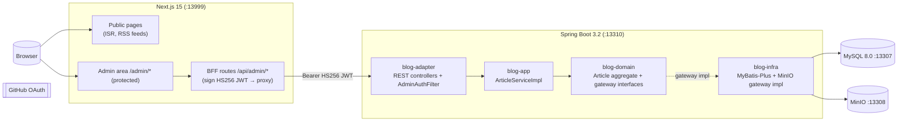

# SealPi-Blog

A full-stack personal blog. Articles are authored in an Excalidraw canvas editor and stored as JSON; a Spring Boot backend serves the content API and a Next.js frontend renders both the public site and the admin area.

Team project (contributors: Seal-Re). Application copy and the design documents under `docs/` are in Chinese.

## Repository layout

```
sealpi-blog/                          # Spring Boot backend (Maven multi-module)
tailwind-nextjs-starter-blog-sealpi/  # Next.js frontend
test/                                 # Manual test + benchmark harnesses (see test/README.md)
docs/                                 # Design and deployment docs (Chinese)
docker-compose.yml                    # MySQL + MinIO + backend + frontend
.env.backend.example                  # Template for .env.backend.local
start-local-test.ps1 / stop-local-test.ps1
```

## Architecture



### Backend modules

The default build has six Maven modules. A seventh module, `blog-bench` (two JMH
benchmarks: `AdminJwtVerifierBenchmark`, `ArticleToPublicVoBenchmark`), is included
only under the `bench` profile.

| Module | Role | Contents |
|---|---|---|
| `blog-client` | API contract | DTOs (cmd/qry/vo), `ArticleServiceI`, `UserServiceI`, `Response` wrappers |
| `blog-app` | Application | `ArticleServiceImpl`, `UserServiceImpl`, `ArticleAssembler` |
| `blog-domain` | Domain | `Article` aggregate, `ArticleGateway` / `UserGateway` interfaces, `ArticleStatus`, `Tag`, `Rely`, `BlogUser` |
| `blog-infra` | Infrastructure | MyBatis-Plus mappers, PO objects, MapStruct converters, `MinioObjectStorage`, Flyway migrations V0–V5 |
| `blog-adapter` | Inbound adapter | REST controllers, `AdminAuthFilter`, `AdminJwtVerifier`, `InternalSyncAuthFilter`, CORS config |
| `blog-start` | Boot | `BlogStartApplication`, aggregated `application.properties`, cache config |

Dependency direction: `start → adapter → app → domain ← infra`. `client` is shared.
The domain model classes (`Article`, `ArticleStatus`, `Tag`) import no Spring or MyBatis
types; the `blog-domain` module itself depends on `spring-boot-starter` and
`spring-boot-starter-validation` for its boot/test scaffolding.

## Content and state model

`ArticleStatus`: `DRAFT(0)` / `PUBLISHED(1)` / `ARCHIVED(2)`. The `Article` aggregate
exposes `saveDraft()`, `publishFromDraft()`, `publish()`, `offlineToDraft()`,
`modify()` and `delete()`.

- `publishFromDraft()` copies `draft_json → content_json` and `draft_body_md → body_md`,
  then sets `PUBLISHED`.
- `offlineToDraft()` returns a published article to `DRAFT`.
- `delete()` sets `ARCHIVED` (terminal); it is exposed by the API as
  `POST /api/v1/admin/articles/{id}/archive`.
- Drafts may have an empty title (stored as `未命名草稿`); publishing requires a title
  and a unique slug.

Content is stored as Excalidraw JSON (`content_json` published, `draft_json` editing),
with an optional Markdown companion (`body_md` / `draft_body_md`) and a generated preview
image used for OpenGraph/SEO. Public responses strip `draftJson` and `draftBodyMd`.
`ArticleVO.readMinutes` is computed from `body_md` using separate CJK (~300 chars/min)
and Latin (~220 words/min) rates.

## Tech stack

Backend (from `sealpi-blog/pom.xml`):

- Java 21, Spring Boot 3.2.11 (`spring-boot-starter-parent`)
- MyBatis-Plus for persistence; no Druid (removed)
- Flyway migrations `V0__init_schema` … `V5__add_t_article_indexes`
- MySQL 8.0 (`mysql:8.0`), MinIO Java client
- Tomcat pinned to 10.1.53, commons-io to 2.14.0 (CVE overrides)
- Tests: `@SpringBootTest` + MockMvc with `@MockBean`, run via `./mvnw -q test`

Frontend (from `tailwind-nextjs-starter-blog-sealpi/package.json`, based on
[tailwind-nextjs-starter-blog](https://github.com/timlrx/tailwind-nextjs-starter-blog) 2.4.0):

- Next.js 15.5.15 (App Router), React 19.0.0
- Tailwind CSS 4, `wb-*` CSS custom properties for theming (single `.dark` remap)
- Contentlayer2 0.5.5, `@excalidraw/excalidraw` 0.18
- NextAuth 5 (beta) with the GitHub provider
- Vitest 4.1.4 — seven test files under `lib/__tests__/`

## Auth

- **Public site**: no auth. `GET /api/v1/articles`, `/articles/{id}`, `/articles/slug/{slug}`,
  `/articles/adjacent`, `/tags`, `POST /articles/{id}/view`, `/feed.xml` and
  `/tags/{tag}/feed.xml`.
- **Admin area**: NextAuth v5 GitHub OAuth; `middleware.ts` protects `/admin/*`. BFF routes
  (`app/api/admin/*`) sign a 15-minute HS256 JWT (`jose`, `ADMIN_JWT_SECRET`) per request and
  forward it as `Authorization: Bearer`; the GitHub access token stays server-side.
- **Backend verification** (`AdminJwtVerifier`): a token with three parts is verified as HS256
  only when `admin.auth.allowLegacyJwt=true`, otherwise it is rejected; any other token is
  treated as a GitHub access token and validated against `api.github.com/user` (3 s connect /
  5 s request timeout). The extracted `githubUserId` is checked against the
  `admin.github.userIds` whitelist.
- **Internal sync**: `POST /api/v1/internal/users/oauth-sync` (header
  `X-Blog-Internal-Sync-Secret`) writes/updates the OAuth user.

Server components must call the backend through `adminServerGet` (`app/api/admin/_utils.ts`)
rather than the BFF routes, because server-side self-fetches do not forward cookies.

## Getting started

Requires Docker Desktop, Node.js 20+, JDK 21. Windows PowerShell:

```powershell
# 1. copy the template and fill in real secrets
cp .env.backend.example .env.backend.local

# 2. start MySQL + MinIO + backend + frontend
.\start-local-test.ps1
#    add -SkipInstall on later runs to skip npm install

# 3. tear down
.\stop-local-test.ps1
```

Ports: frontend `13999`, backend `13310`, MySQL `13307`, MinIO API `13308`, MinIO console `13309`.

Alternatively, run each piece directly:

```bash
cd sealpi-blog && ./mvnw -q test                       # backend tests
cd sealpi-blog && ./mvnw -q package -DskipTests        # build the backend jar
cd tailwind-nextjs-starter-blog-sealpi && npm ci       # frontend install
npm run lint && npm test && npx next build             # lint, unit tests, build
docker compose --env-file .env.backend.local up -d     # whole stack in containers
```

Key environment variables (see `.env.backend.example` for the full list): `MYSQL_ROOT_PASSWORD`,
`MINIO_ROOT_USER` / `MINIO_ROOT_PASSWORD`, `MINIO_PUBLIC_BASE_URL`, `ADMIN_JWT_SECRET`,
`ADMIN_AUTH_ALLOW_LEGACY_JWT`, `ADMIN_GITHUB_USERIDS`, `BLOG_INTERNAL_SYNC_SECRET`,
`GITHUB_ID` / `GITHUB_SECRET`, `AUTH_SECRET`, `AUTH_URL`, `NEXT_PUBLIC_BLOG_API_BASE_URL`.

## CI

`.github/workflows/ci.yml` runs three jobs on push/PR:

1. `backend` — Temurin JDK 21 + Maven cache → `./mvnw -q test`
2. `frontend` — Node 20 + `npm ci` → lint → `npm test` → `npx next build`
3. `docker-compose` — `docker compose build --no-cache` then `up -d` smoke check

Two more workflows exist: `deploy.yml` (builds and pushes images to GHCR on `main`) and
`cleanup-latest-tag.yml`.

## Limitations

- Docker image builds may fail on Windows (`exec format error`); CI is the reliable path.
- `sealpi-blog/null/` contains legacy auto-generated code and is not part of the build.

## License

MIT. See [LICENSE](LICENSE).
